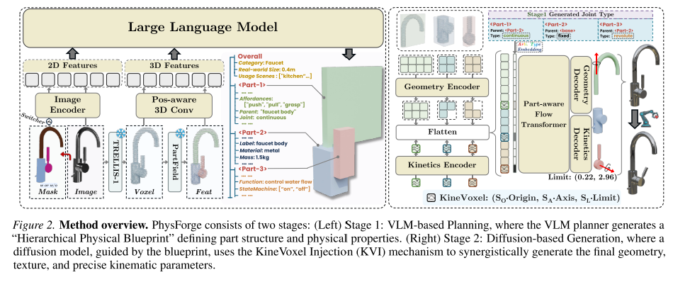

物理驱动三维交互资产生成

一幅输入图像即可生成基于物理的3D资源

1. 部件通过不同颜色来区分，以显示几何图形

2. 部件使用其详细的物理属性进行注释

3. 可移动部件的运动参数由箭头精确指示

vlm拥有复杂物理规划所需的世界知识，但扩散模型擅长运动参数，几何和纹理的精确综合

第一阶段

微调一个vlm,使得其获得3D空间理解和零件结构规划能力，同时保留其固有的世界知识。以图像，可选的2D遮罩和生成的3D体素为输入，任务是生成分层物理蓝图

第二阶段

基于扩散的生成，KineVoxel（KVI\)机制，将精确的关节参数（原点，轴，限制）编码到一个特殊的运动学体素，实现几何形状和运动学参数协同合成

数据集：PhyDB 15万个资产的大型数据集

四层标注系统：在哪里，多大；由什么组成；用来干嘛；怎么动

1. 整体层：全局属性：真实世界规模和使用场景

2. 静态层：语义标签，物理材料，质量

3. 功能层：部件属性：内在功能和状态机

4. 交互层：运动学属性：关节类型和原子可供性

---

# Related work

使用强大的2D先验或者直接使用3D数据进行训练

1. SDS，DreamFusion提出，用2D扩散模型的梯度来优化一个3D表示；后续很多工作，包括多视角图形生成再重建3D

2. 3D原生生成，直接在大规模数据集上训练生成模型，核心是Latent Diffusion

3DShape2VecSet:交叉注意力，3D形状编码为固定长度的潜在向量集合

CLAY：扩展到超大规模数据集，生成几何和基于物理的渲染材质

TRELLIS：引入结构化潜在表示，先生成稀疏体素结构，再在活跃体素上生成细节

问题：都是整体性的且不可交互的

## 部件感知的3D形状生成

从视图重建：保真度低，表面级别的分割

OmniPart:引入一个基于TRELLIS构建的两阶段框架，实现语义解耦和结构连贯性，支持可控的部件生成

PartPacker:表示效率，所有部件压缩为一个紧凑的双重体积表示

问题：都仅仅基于几何或视觉边界来定义“部件”；部件的功能和物理属性从未被考虑在内

## 物理基础的3D形状生成

物体整体属性

EmbodiedGen

PhysX\-3D，引入了PhysXNet,物理变分自编码器

关节物体的重建

关节物体的程序化生成

---

基于物理，部分感知的3D资源生成

